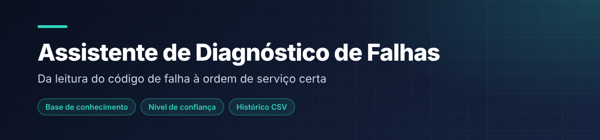
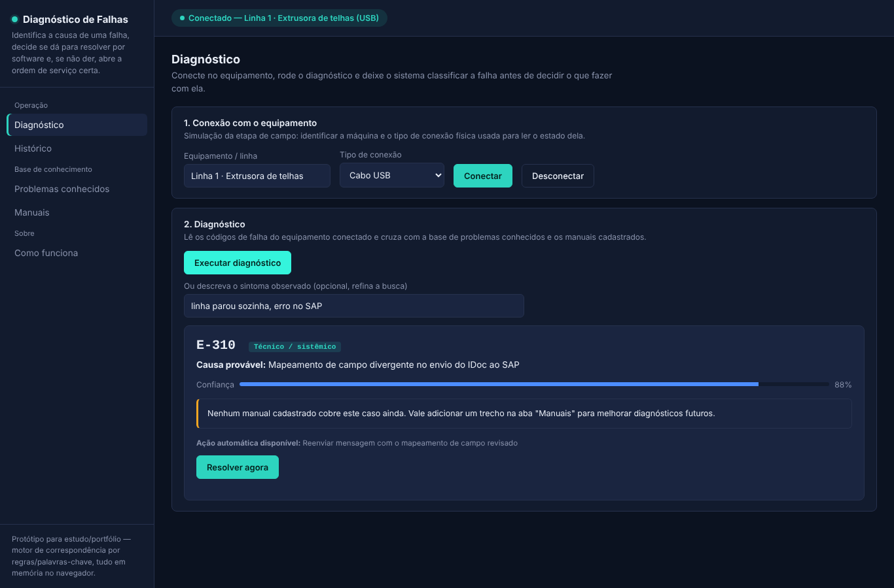

  

<h1 align="center">Assistente de Diagnóstico e Resolução de Falhas</h1>

Identifica a causa de uma falha em máquinas, decide se dá para resolver por software e, se não der, orienta a abertura da ordem de serviço certa.

  

    

---

## 📌 Sobre

Protótipo que cruza códigos de falha e sintomas com uma base de problemas conhecidos e manuais cadastrados para sugerir a causa mais provável. Falhas técnicas/sistêmicas têm correção automática; falhas físicas encaminham para manutenção.

## 🖼️ Demonstração

  
   Diagnóstico com causa provável, nível de confiança e ação automática

## ✨ Funcionalidades

- Simulação da conexão com o equipamento (cabo **USB** ou **Bluetooth**)
- Diagnóstico por correspondência de códigos e sintomas, com **nível de confiança**
- Classificação da falha como técnica/sistêmica (correção automática) ou física (manutenção)
- Cadastro de novos problemas e manuais na base de conhecimento
- Histórico de diagnósticos exportável em **CSV**

## 🛠️ Tecnologias

`HTML5` · `CSS3` · `JavaScript`

## ▶️ Como usar

Abra a demo, ou baixe o repositório e abra o `index.html` no navegador. Conecte o equipamento simulado, execute o diagnóstico e use **Resolver agora** ou **Abrir ordem de serviço**.

Não precisa instalar nada nem rodar servidor: é só HTML, CSS e JavaScript.

## 📝 Observações

Protótipo de estudo/portfólio: motor de correspondência por regras e palavras-chave, tudo em memória no navegador. A conexão USB/Bluetooth é simulada.

---

## 👤 Autor

**Daniel da Silva Rezende** — estudante de Engenharia de Software e Análise e Desenvolvimento de Sistemas.

